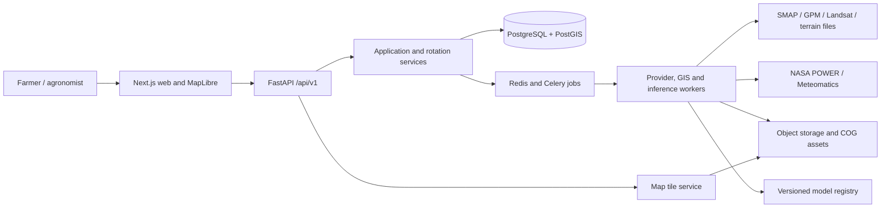

# System overview

## Runtime boundaries

Frontend owns map interaction, forms, charts, and presentation. The API validates/authorizes requests, coordinates services, and publishes stable contracts. PostgreSQL/PostGIS stores identity, field geometries, catalog/asset metadata, job/prediction/rotation records and audit events; raster binaries stay in file/object storage. Redis/Celery handles bounded asynchronous work. GIS modules validate and derive source-aligned assets. ML modules version datasets, features, models, metrics and explanations. Provider adapters are limited to the six locked MVP sources.

## Data flow

Farmer field/history → catalog and coverage lookup → local/object asset or approved API request → source QA → interim processing → validated processed indicators → model-ready features → versioned inference → agronomic hard constraints and rotation ranking → evidence and limitations → map/dashboard/report. Results retain source, observation date, quality, scale, processing version, model version and review state.

## Team boundaries

Four ownership areas cover web/map, API/services, database/infrastructure, and data/GIS/AI. Shared API, layer, dataset, feature and crop schemas are reviewed by affected owners. See `docs/development/folder-ownership.md`.
