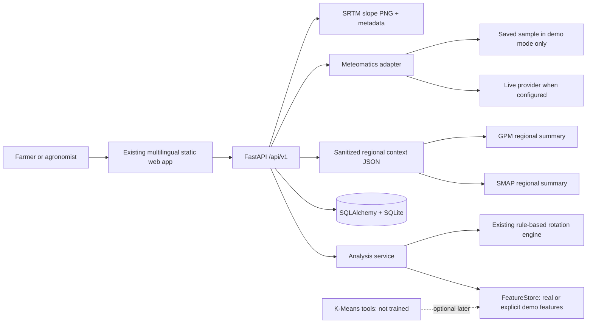

# Implemented runtime overview

## Active runtime

The existing static frontend is served by FastAPI. The API validates inputs and calls the original crop rotation engine. It reads the nearest validated point from `data/features/features.json` in real mode; when missing, it returns `insufficient_data`. The explicit demo launcher selects the supplied example row and the UI keeps a persistent demo banner.

SQLAlchemy persists requests/results and metadata in SQLite. The context route serves safe SMAP/GPM summaries without treating them as field features. Terrain layers are static PNG files whose bounds/source/date/resolution come from metadata. Meteomatics calls are server-side; a saved response can be used only when demo mode is enabled. NASA POWER can parse a local saved CSV or use the existing configured live option.

The separate K-Means package is intended to group real environmental feature rows. It is not used by rotation recommendations and has no trained artifacts at present.

## Preserved architecture artifacts

Older ADRs and infrastructure docs describe a larger future architecture, including Next.js, PostGIS, Redis/Celery, object storage and deployment targets. Those are retained as project history. They are not active hackathon MVP dependencies and were not introduced into this runtime.
